# ZeRO from scratch: 32 virtual GPUs, one small GPT, and where every byte goes

A step by step guide for someone who has trained a model on one machine and now wants to understand how big models are trained on many.

You will train a small language model (4.2 million numbers) on 32 "virtual GPUs", which are 32 ordinary processes on a Mac CPU, talking to each other the same way real GPUs do. You will train it four times: once with plain data parallelism (DDP), then with ZeRO stage 1, 2 and 3. The model learns the same thing every time, down to the last digit. What changes is how much memory each GPU needs and how many bytes they send each other. By the end you will have:

- counted, by hand, every byte one GPU holds during training, for 8 parameters on 4 GPUs
- run the two operations everything in this guide is built from, reduce-scatter and all-gather, and said what each one costs
- written ZeRO-1, ZeRO-2 and ZeRO-3 yourself, about 450 lines with comments, and checked that they end with the same weights as PyTorch's own AdamW, to within 0.0000004
- watched one GPU's memory drop from 67.7 MB to 2.1 MB as the stages shard more, while the loss curve does not move
- measured the price: ZeRO-3 sends 1.4 times the bytes of DDP on our model, and found out why the paper's number (1.5) is a little different

This guide builds on two earlier ones. [a10-pipeline](../a10-pipeline/guide.md) trained the same small GPT on one machine and explained the memory bill of a training step (its Part 9). [a14-MOE](../a14-MOE/guide.md) ran a model on two GPUs with a hand-written gradient all-reduce. You do not need to have read them; every term is explained the first time it appears, and there is a glossary at the end. If you have read them, you will recognise `model.py`, the dimension letters, and the plotting style.

How to read this guide. Parts 1 to 9 are the "lecture": what each piece is, with small numbers you can check on paper. Parts 10 to 19 are the "lab": how to run it, how to read the output, and what our runs measured. Each lecture part ends with a few "check yourself" questions; the answers are folded underneath, so try first. If you are impatient, jump to Part 10 and come back when an output confuses you.

All numbers in the lab come from `runs.sh` (or the notebook `zero.ipynb`, which runs the same commands) on a MacBook Air M4 (10 CPU cores, 16 GB).

---

## Contents

**Lecture**

1. [The wall: why one GPU is not enough](#part-1-the-wall-why-one-gpu-is-not-enough)
2. [Where the bytes go](#part-2-where-the-bytes-go)
3. [Data parallelism, and the waste inside it](#part-3-data-parallelism-and-the-waste-inside-it)
4. [Collectives: the four verbs GPUs speak](#part-4-collectives-the-four-verbs-gpus-speak)
5. [ZeRO-1: shard the optimizer state](#part-5-zero-1-shard-the-optimizer-state)
6. [ZeRO-2: shard the gradients too](#part-6-zero-2-shard-the-gradients-too)
7. [ZeRO-3: shard the weights too](#part-7-zero-3-shard-the-weights-too)
8. [What it costs: communication](#part-8-what-it-costs-communication)
9. [What ZeRO does not touch, and where to go next](#part-9-what-zero-does-not-touch-and-where-to-go-next)

**Lab**

10. [Setting up: 32 virtual GPUs on a Mac](#part-10-setting-up-32-virtual-gpus-on-a-mac)
11. [A tour of zero.py](#part-11-a-tour-of-zeropy)
12. [Proving the stages are the same](#part-12-proving-the-stages-are-the-same)
13. [Memory at N = 32](#part-13-memory-at-n--32)
14. [The scaling sweep](#part-14-the-scaling-sweep)
15. [One step, allocation by allocation](#part-15-one-step-allocation-by-allocation)
16. [Communication and time](#part-16-communication-and-time)
17. [When things go wrong](#part-17-when-things-go-wrong)
18. [Experiments to try next](#part-18-experiments-to-try-next)
19. [Glossary](#part-19-glossary)

---

## Part 1: The wall: why one GPU is not enough

### 1.1 The arithmetic

Training a model with the Adam optimizer in mixed precision costs 16 bytes per parameter before you store a single activation. Part 2 shows where the 16 comes from. For now, take it and multiply:

| model | parameters | 16 bytes each | fits on one 80 GB GPU? |
|---|---|---|---|
| our GPT | 4.2 million | 68 MB | easily |
| GPT-2 XL | 1.5 billion | 24 GB | yes |
| Llama-style 7B | 7 billion | 112 GB | no |
| 70B | 70 billion | 1,120 GB | no, not even close |

The largest GPU you can buy holds 80 to 192 GB. A 7B model does not fit for training, even though it fits for inference (7B x 2 bytes = 14 GB to just run it). Training needs eight times more memory per parameter than running.

### 1.2 The obvious fix, and why it does not help

The obvious fix is "use more GPUs". The most common way to use more GPUs is data parallelism: every GPU gets a full copy of the model and a different slice of the data (Part 3). That makes training faster. It does nothing for memory: with 64 GPUs, each one still needs 112 GB for a 7B model. You bought 64 GPUs and you have the memory of one, 64 times over.

ZeRO ("Zero Redundancy Optimizer", Rajbhandari et al., 2020) fixes this. Its idea fits in one sentence: **if 64 GPUs each hold the same thing, let each hold 1/64 of it and borrow the rest when needed.** The paper's own example, a 7.5B model on 64 GPUs, shows what that buys:

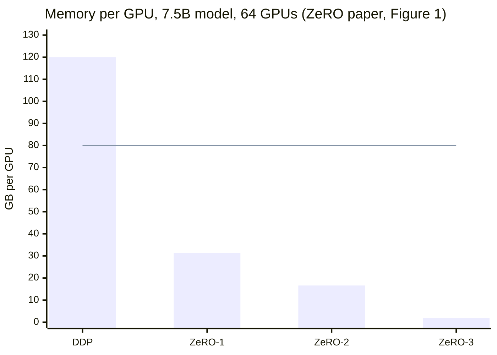

The line is an 80 GB GPU. DDP needs 120 GB and does not fit. ZeRO-1 needs 31.4 GB, ZeRO-2 16.6 GB, ZeRO-3 1.9 GB. Same model, same GPUs, same result.

### 1.3 What we build in this guide

Real GPUs cost money, so we fake them. A "virtual GPU" here is one operating-system process. 32 processes on one Mac each run their own copy of the training loop and talk to each other through `torch.distributed`, the same library and the same function calls (`all_reduce`, `reduce_scatter_tensor`, `all_gather_into_tensor`) you would use on a cluster. Only the wire changes: real GPUs use NVLink or InfiniBand, we use the gloo backend over local network sockets.

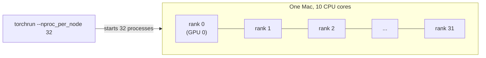

"Rank" is the word for "which GPU am I", numbered 0 to N-1. N is the number of ranks, also called the world size.

What faking costs us: speed. Our 32 ranks share 10 cores, and gloo is slower than NVLink by a factor of hundreds. So we never trust our timings as absolute numbers. Memory and bytes sent, on the other hand, are exact: they do not depend on how fast the hardware is.

<details>
<summary>Check yourself</summary>

1. A 13B model, Adam, mixed precision. How many GB for model states, and does it fit on one 80 GB GPU?
2. With DDP on 8 GPUs, how many GB does each GPU need for that 13B model?
3. Which of these does the virtual-GPU setup measure faithfully: step time, bytes held per rank, bytes sent per rank?

**Answers.** 1: 13 x 16 = 208 GB, no. 2: still 208 GB each; DDP copies everything. 3: bytes held and bytes sent. Step time depends on the hardware, and ours is a laptop CPU pretending.
</details>

---

## Part 2: Where the bytes go

### 2.1 Four kinds of memory

When a model trains, each GPU holds four kinds of things:

| what | what it is | size grows with |
|---|---|---|
| weights (parameters) | the numbers the model learns | model size |
| gradients | for each weight, which way and how much to change it | model size |
| optimizer state | the optimizer's memory about each weight | model size |
| activations | values from the forward pass kept for backward | batch size x sequence length |

The first three are called **model states**. They are what ZeRO shards. Activations are a different problem with different fixes (Part 9).

### 2.2 The 16 bytes

Modern training uses mixed precision. The forward and backward passes run in bf16 (2 bytes per number) because on a GPU it is fast and small. (On this Mac's CPU it is small but 270 times slower than fp32; Part 10 tells that story.) But tiny updates get lost when added to bf16 numbers (a10's guide, Part 8, shows why bit by bit), so the optimizer keeps its own fp32 (4-byte) copy of every weight, called the **master weights**, and does the update there.

Adam also keeps two running averages per weight: **m**, the average gradient (which way have we been going?), and **v**, the average squared gradient (how bumpy has it been?). Both in fp32.

Count them, per parameter:

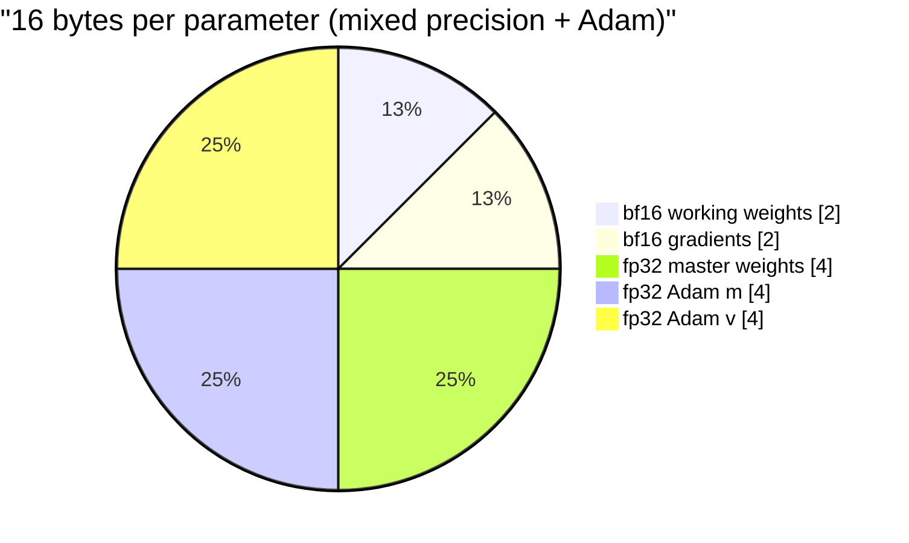

2 + 2 + 4 + 4 + 4 = 16. The ZeRO paper writes this as 2Ψ + 2Ψ + KΨ with K = 12, where Ψ (the Greek letter psi) is the number of parameters. I will use Ψ the same way: **Ψ always means "the number of parameters"**, and "2Ψ bytes" means "two bytes for every parameter".

The surprise in that picture: three quarters of the memory is the optimizer, not the model. The weights you actually compute with are 2 of the 16 bytes.

### 2.3 The running example: 8 parameters, 4 GPUs

We will carry one tiny example through every part of the lecture. A model with 8 parameters, w0 to w7, trained on 4 GPUs (G0 to G3). Small enough to draw every byte.

Each GPU, with plain data parallelism, holds:

| item | numbers | bytes each | bytes |
|---|---|---|---|
| bf16 weights | 8 | 2 | 16 |
| bf16 gradients | 8 | 2 | 16 |
| fp32 master, m, v | 8 x 3 | 4 | 96 |
| **total per GPU** | | | **128** |
| **total over 4 GPUs** | | | **512** |

Of the 512 bytes, how many are different from each other? Only 128. Every GPU holds the same weights, the same averaged gradients, the same optimizer state. 384 bytes are copies. That redundancy is the "R" ZeRO removes.

### 2.4 An analogy we will use all the way through

Four students study together from one huge textbook. Each has:

- **the textbook** (weights): needed to do any practice problem.
- **their correction notes** (gradients): after a practice problem, which sentences of the book need fixing and how.
- **the editing binder** (optimizer state): a careful full-size draft of the book plus two notebooks tracking how each sentence has been changing. It is six times as thick as the book.

Every evening they compare correction notes, agree on the fixes, and each one edits their own copy of the book and binder identically. Four students, four identical binders. Hold on to this picture; each ZeRO stage takes one pile off the desk.

<details>
<summary>Check yourself</summary>

1. Why does the optimizer keep fp32 master weights if the model already has bf16 weights?
2. In our 8-parameter example, how many of each GPU's 128 bytes are optimizer state?
3. Our GPT has 4,231,680 parameters. How many MB of model states does one DDP rank hold?

**Answers.** 1: a small update added to a bf16 number can round away to nothing; in fp32 it survives. 2: 96 bytes, three quarters. 3: 4,231,680 x 16 = 67.7 MB. Part 13 measures exactly this.
</details>

---

## Part 3: Data parallelism, and the waste inside it

### 3.1 How DDP trains

DDP (Distributed Data Parallel) is the standard way to train on several GPUs. Every GPU:

1. holds a full copy of the model,
2. runs forward and backward on its own slice of the batch, which gives it its own gradient,
3. joins an **all-reduce** that adds up everyone's gradients, so every GPU ends with the same total,
4. runs the optimizer on the full model, and since everyone started equal and applied the same update, everyone stays equal.

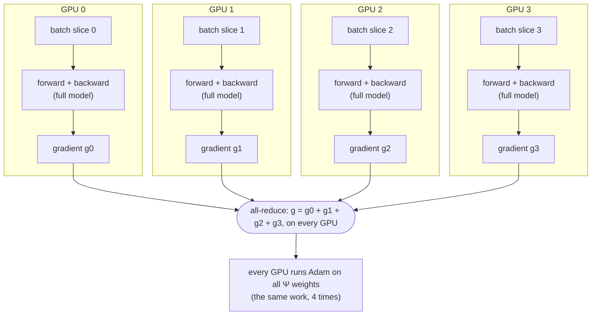

Each GPU does a quarter of the forward-backward work. That is the speedup. The optimizer step is not split at all: all four GPUs do the full update.

### 3.2 The running example

Each GPU computes a gradient from its own data. Say they come out as:

| | w0 | w1 | w2 | w3 | w4 | w5 | w6 | w7 |
|---|---|---|---|---|---|---|---|---|
| G0 | 1 | 2 | 0 | 1 | 3 | 0 | 1 | 2 |
| G1 | 0 | 1 | 1 | 2 | 1 | 1 | 0 | 2 |
| G2 | 2 | 0 | 3 | 1 | 0 | 2 | 1 | 1 |
| G3 | 1 | 1 | 2 | 0 | 2 | 1 | 2 | 3 |
| **sum** | **4** | **4** | **6** | **4** | **6** | **4** | **4** | **8** |

After the all-reduce, all four GPUs hold the bottom row. Then all four run Adam on all 8 weights, and get the same 8 new weights.

A detail worth knowing: we want the gradient of the average loss over the whole global batch, not the sum. Our `train.py` divides each GPU's loss by the token count of the global batch before backward, so the sum over GPUs is already the average. No division needed after the all-reduce. (a10's guide, Part 6, explains why "divide by the total" and not "average the averages".)

### 3.3 The waste

Look at step 4 again. Four GPUs each store the full optimizer state and each do the full update, and they all compute exactly the same answer. In the analogy: four students each maintain an identical six-times-the-book binder.

ZeRO's three stages remove this copying one pile at a time:

| stage | what each GPU keeps only 1/N of |
|---|---|
| ZeRO-1 | optimizer state |
| ZeRO-2 | optimizer state, gradients |
| ZeRO-3 | optimizer state, gradients, weights |

Before we can build them, we need two operations.

<details>
<summary>Check yourself</summary>

1. With DDP on 4 GPUs, how much forward-backward work does each GPU do, compared to one GPU training alone on the same global batch? How much optimizer work?
2. Why do all DDP replicas stay identical without ever sending each other weights?

**Answers.** 1: a quarter of the forward-backward, the full optimizer step. 2: they start from the same weights (same random seed), receive the same summed gradient, and run the same deterministic update.
</details>

---

## Part 4: Collectives: the four verbs GPUs speak

### 4.1 What a collective is

A **collective** is an operation every rank calls at the same time, with a buffer of the same size, and that ends with some combination of everyone's data. If one rank does not call it, the others wait until a timeout (30 minutes by default with gloo) and then crash; Part 17 has the error message. Four of them matter here. Using our gradient table, 4 GPUs, 8 numbers each, cut into 4 chunks of 2 (chunk k is w(2k) and w(2k+1)):

```mermaid
flowchart LR
    subgraph before["Before: each GPU has its own 8 numbers"]
        direction TB
        a0["G0: 1 2 | 0 1 | 3 0 | 1 2"]
        a1["G1: 0 1 | 1 2 | 1 1 | 0 2"]
        a2["G2: 2 0 | 3 1 | 0 2 | 1 1"]
        a3["G3: 1 1 | 2 0 | 2 1 | 2 3"]
    end
    subgraph rs["reduce-scatter: sum, keep only my chunk"]
        direction TB
        r0["G0: 4 4"]
        r1["G1: 6 4"]
        r2["G2: 6 4"]
        r3["G3: 4 8"]
    end
    subgraph ag["all-gather: everyone gets every chunk"]
        direction TB
        x0["G0: 4 4 | 6 4 | 6 4 | 4 8"]
        x1["G1: 4 4 | 6 4 | 6 4 | 4 8"]
        x2["G2: 4 4 | 6 4 | 6 4 | 4 8"]
        x3["G3: 4 4 | 6 4 | 6 4 | 4 8"]
    end
    before --> rs --> ag
```

| collective | input on each rank | output on each rank |
|---|---|---|
| **all-reduce** | a full buffer | the sum of everyone's full buffers |
| **reduce-scatter** | a full buffer | 1/N of the sum: chunk r of it on rank r |
| **all-gather** | one chunk | every rank's chunk, side by side |
| **broadcast** | rank 0's buffer | a copy of it (we only use it implicitly: same seed instead) |

Read the picture left to right and notice: **reduce-scatter followed by all-gather is exactly all-reduce.** That sentence is the key to all of ZeRO. DDP calls the two halves in one go. ZeRO pulls them apart and does useful work in the gap between them.

### 4.2 What each one costs: the ring

How many bytes does each GPU send? The standard algorithm arranges GPUs in a ring, each sending only to its right neighbour:

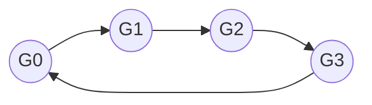

**Ring reduce-scatter.** Cut the buffer into N chunks. In each of N-1 rounds, every GPU sends one chunk to its neighbour, who adds its own copy of that chunk and passes the running sum along next round. After N-1 rounds each chunk has visited every GPU and its full sum has landed on one of them. Each GPU sent N-1 chunks, each of size 1/N of the buffer.

**Ring all-gather.** Same ring, N-1 rounds, but instead of adding, each GPU just forwards the chunk it received. Again N-1 chunks sent per GPU.

So for a buffer of M bytes, each GPU sends:

| collective | bytes sent per GPU | for large N |
|---|---|---|
| reduce-scatter | (N-1)/N x M | about M |
| all-gather | (N-1)/N x M | about M |
| all-reduce = both | 2 (N-1)/N x M | about 2M |

The remarkable part: **the cost per GPU barely depends on N.** Adding GPUs does not make each GPU send more. (It makes the ring longer, so latency grows, but for big buffers bandwidth dominates.) This is why the ZeRO paper counts communication in units of Ψ and ignores the (N-1)/N: at N = 64 it is 0.98.

For our example (M = 8 bf16 numbers = 16 bytes, N = 4): all-reduce sends 2 x 3/4 x 16 = 24 bytes per GPU. Our `Comm` class counts exactly this formula for every collective it runs.

<details>
<summary>Check yourself</summary>

1. After a reduce-scatter on 4 GPUs, what does G2 hold in our example?
2. You have a reduce-scattered gradient (each GPU has its chunk of the sum). Which collective gives every GPU the full sum?
3. An all-reduce of a 1 GB buffer on 1,000 GPUs: about how many bytes does each GPU send?

**Answers.** 1: the sums for w4 and w5, which are 6 and 4. 2: all-gather. 3: 2 x 999/1000 x 1 GB, about 2 GB. The same as on 10 GPUs (1.8 GB).
</details>

---

## Part 5: ZeRO-1: shard the optimizer state

### 5.1 The idea

The optimizer is the biggest pile (12 of 16 bytes), and in DDP every GPU does the same update. So split it: **GPU r keeps the master weights, m and v only for chunk r, and updates only chunk r.** Then it shares its updated chunk with everyone.

Because reduce-scatter plus all-gather equals all-reduce, this costs nothing extra in communication. Here is a ZeRO-1 step:

1. Forward and backward on the full model, as in DDP. Each GPU has a full gradient.
2. **Reduce-scatter** the gradient: GPU r receives the summed gradient for chunk r only.
3. GPU r runs Adam on chunk r: its fp32 master weights, m and v for that chunk.
4. GPU r converts its updated chunk to bf16 and joins an **all-gather**, so every GPU has the full new weights.

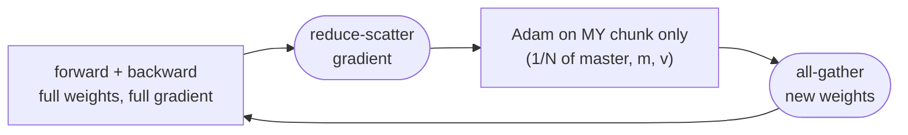

Compare with DDP's all-reduce: the same two halves, with the optimizer moved into the middle.

### 5.2 The running example

G2 owns chunk 2 (w4, w5). After the reduce-scatter it holds summed gradients 6 and 4. It runs Adam on w4 and w5 only, using its own master copies and m, v for those two. Then the all-gather hands everyone the new w4, w5 from G2, the new w0, w1 from G0, and so on.

Bytes per GPU:

| item | DDP | ZeRO-1 |
|---|---|---|
| bf16 weights | 8 x 2 = 16 | 16 |
| bf16 gradients | 8 x 2 = 16 | 16 |
| fp32 master, m, v | 8 x 12 = 96 | **2 x 12 = 24** |
| **total** | **128** | **56** |

In formulas, per GPU: 2Ψ + 2Ψ + 12Ψ/N. As N grows, the optimizer term vanishes and you are left with 4Ψ: four times smaller than DDP's 16Ψ. For the paper's 7.5B model on 64 GPUs: 4 x 7.5 + 12 x 7.5 / 64 = 30 + 1.4 = 31.4 GB.

In the analogy: each student keeps the binder only for their quarter of the chapters. After comparing notes, each edits their own chapters in their binder, then photocopies the fresh chapters for the others.

### 5.3 What changed in compute

Forward and backward: unchanged. The optimizer step: each GPU now updates Ψ/N numbers instead of Ψ. For a big model the optimizer step is a small part of the time anyway, but it was pure duplicated work, and now it is not.

<details>
<summary>Check yourself</summary>

1. In ZeRO-1, does any GPU ever hold the full fp32 master weights?
2. Why does ZeRO-1 send the same number of bytes as DDP?
3. ZeRO-1 on our 4.2M-parameter GPT with N = 32: predict the bytes per rank for each of the three model states.

**Answers.** 1: no; each holds 1/N of them. 2: DDP's all-reduce is a reduce-scatter plus an all-gather; ZeRO-1 does those same two, with the optimizer in between. 3: weights 8.46 MB, gradients 8.46 MB, optimizer 50.78 / 32 = 1.59 MB. Total 18.5 MB, against DDP's 67.7 MB.
</details>

---

## Part 6: ZeRO-2: shard the gradients too

### 6.1 The idea

Look at ZeRO-1 again. After the reduce-scatter, GPU r only ever uses the gradient for chunk r. The full gradient buffer it kept is dead weight. So **don't keep it**: as soon as a gradient is summed and scattered, free the parts you do not own.

The catch is timing. If you wait until backward has finished and then reduce-scatter, the full gradient existed at full size for a moment, and that moment is your peak memory. ZeRO-2 instead reduce-scatters **during** backward, piece by piece, as soon as each piece of the gradient is complete.

### 6.2 Units: the pieces we move

Our code cuts the model into **units**. Each transformer block is one unit. The embedding table, the final LayerNorm and the output head form one more unit, unit 0 (they must be one unit, because the output head reuses the embedding matrix: "weight tying", explained in a10's guide). For our GPT:

| unit | parameters |
|---|---|
| unit 0: embed + head | 1,081,856 |
| block 0 | 787,456 |
| block 1 | 787,456 |
| block 2 | 787,456 |
| block 3 | 787,456 |
| total Ψ | 4,231,680 |

Backward runs the model in reverse: output head first, then block 3, 2, 1, 0, then the embedding lookup. The moment the last parameter of a block has its gradient, a hook fires, and the block's gradient is reduce-scattered and freed.

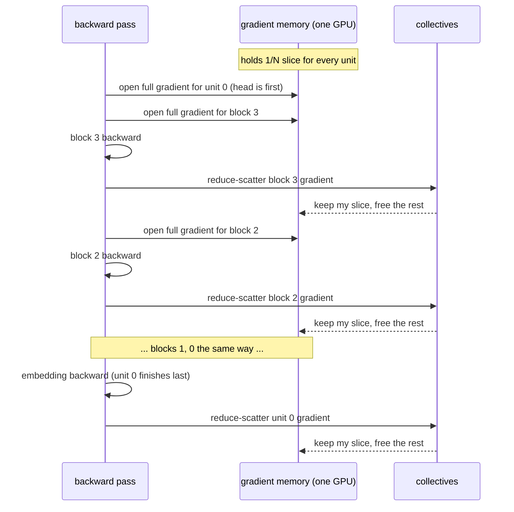

At any moment at most two full unit gradients exist: unit 0's (open for the whole backward because the head comes first and the embedding last) and one block's. The rest is slices.

### 6.3 The running example, and the formula

Bytes per GPU, between steps:

| item | DDP | ZeRO-1 | ZeRO-2 |
|---|---|---|---|
| bf16 weights | 16 | 16 | 16 |
| bf16 gradients | 16 | 16 | **2 x 2 = 4** |
| fp32 master, m, v | 96 | 24 | 24 |
| **total** | **128** | **56** | **44** |

Formula: 2Ψ + 2Ψ/N + 12Ψ/N, which approaches 2Ψ for large N: eight times smaller than DDP. The paper's 7.5B on 64 GPUs: 15 + 14 x 7.5 / 64 = 16.6 GB.

Communication: still one reduce-scatter and one all-gather of Ψ numbers per step. Unchanged.

In the analogy: when comparing correction notes, each student only writes down the agreed fixes for their own chapters and throws away the rest.

### 6.4 Gradient clipping when nobody has the whole gradient

Gradient clipping (a10's guide, Part 7) needs the length of the whole gradient vector: the square root of the sum of squares of all Ψ numbers. In DDP every GPU has the full summed gradient and computes it alone. In ZeRO-2 no GPU has it.

The fix is small and worth seeing once: each GPU sums the squares of its own slice, then one all-reduce of **a single number** adds the slices' sums, and every GPU takes the square root.

```
norm² = (sum of squares on G0) + (sum on G1) + (sum on G2) + (sum on G3)
```

In our example: G0 has [4, 4], G1 [6, 4], G2 [6, 4], G3 [4, 8]. Slice sums: 32, 52, 52, 80. Total 216, norm 14.7. One 8-byte all-reduce, and every rank clips with the same factor. It is a good example of a general rule: once data is sharded, any "global" number (norms, loss averages, counts) needs one more collective.

<details>
<summary>Check yourself</summary>

1. Why does ZeRO-2 have to reduce-scatter during backward instead of after it?
2. Why is unit 0's full gradient open for the entire backward pass?
3. Compute the gradient norm for the running example by adding the four slice sums yourself. Does it match the norm of the full summed row [4, 4, 6, 4, 6, 4, 4, 8]?

**Answers.** 1: if you wait, the full gradient exists at full size at the end of backward, and the peak is the same as ZeRO-1's. 2: it holds the output head (the first thing backward reaches) and the embedding (the last thing), so it cannot finish before everything else has. 3: 16+16 + 36+16 + 36+16 + 16+64 = 216, and the full row's squares also add to 216. Same norm, √216 ≈ 14.7.
</details>

---

## Part 7: ZeRO-3: shard the weights too

### 7.1 The idea

The weights are the last copied pile. ZeRO-3 shards them too: **each GPU permanently stores only its 1/N slice of every unit's weights.** But forward and backward need full weights. So just before a unit runs, the GPUs all-gather its weights; right after, they throw the full copy away.

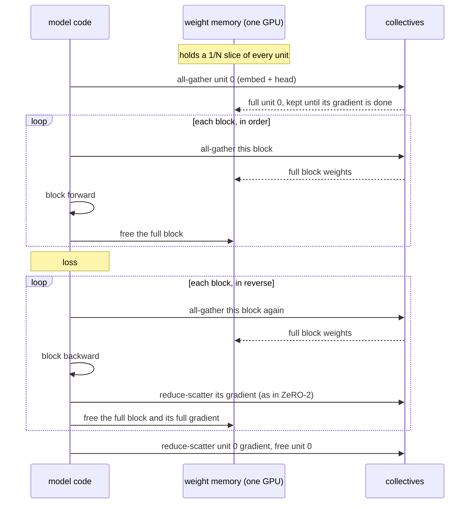

Every block is gathered twice per step: once for forward, once for backward. That is ZeRO-3's price (Part 8).

### 7.2 How the code fetches and frees, without changing the model

`model.py` is exactly a10's model; it has no idea it is being sharded. The trick is in PyTorch **hooks**: functions you attach to a module that PyTorch calls at the right moment.

- A **forward pre-hook** on each block runs just before the block's forward: all-gather its weights.
- A **forward hook** runs just after: free the full weights, and attach a hook to the block's output tensor.
- That **tensor hook** fires during backward, at the moment the gradient reaches the block's output, just before the block's own backward: all-gather the weights again and open a full gradient buffer.
- A **post-accumulate-grad hook** on every parameter fires when its gradient is complete. When the last one in a unit fires: reduce-scatter, free.

"Free" here means literally shrinking the tensor's storage to zero bytes (`untyped_storage().resize_(0)`), then growing it back and filling it on the next gather. PyTorch's own FSDP uses the same trick. Part 11 walks through these lines.

### 7.3 The running example, and the formula

| item | DDP | ZeRO-1 | ZeRO-2 | ZeRO-3 |
|---|---|---|---|---|
| bf16 weights | 16 | 16 | 16 | **4** |
| bf16 gradients | 16 | 16 | 4 | 4 |
| fp32 master, m, v | 96 | 24 | 24 | 24 |
| **total** | **128** | **56** | **44** | **32** |

ZeRO-3's total is DDP's divided by N: 128 / 4 = 32. Formula: 16Ψ/N. Every byte of model state exists exactly once across the cluster. The paper's 7.5B on 64 GPUs: 120 / 64 = 1.9 GB. With enough GPUs, there is no model too big.

In the analogy: each student owns only their chapters of the book. When the group reaches chapter 3, its owner photocopies it for everyone, they all work through it, then shred the copies.

### 7.4 Between steps vs during a step

The table above is memory **between** steps. During a step, ZeRO-2 and ZeRO-3 briefly hold full buffers for one or two units at a time. So the peak is:

| stage | peak extra on top of the between-steps number |
|---|---|
| DDP, ZeRO-1 | nothing for DDP (all full buffers are always there); ZeRO-1 adds a 2Ψ/N gradient-slice buffer for its reduce-scatter, which is 0.26 MB at N = 32 but the whole gradient at N = 1 |
| ZeRO-2 | full gradients of unit 0 and one block |
| ZeRO-3 | full weights and full gradients of unit 0 and one block |

Notice that the extra does not shrink with N: it is a fixed number of full units. For a real model with 80 layers, one layer is 1/80 of the model, so the extra is small. For our toy with 4 blocks and a big embedding unit, it is large (3.7 MB for ZeRO-2 and 7.5 MB for ZeRO-3 at every N), and Part 15 shows it.

<details>
<summary>Check yourself</summary>

1. In ZeRO-3, how many times is each block's weight gathered per training step? And unit 0?
2. Why can't ZeRO-3 free unit 0 after the forward pass, the way it frees blocks?
3. Fill in ZeRO-3's bytes for our 4.2M-parameter GPT at N = 32.

**Answers.** 1: each block twice (forward and backward); unit 0 once, because we keep it for the whole step. 2: the output head, which reuses unit 0's embedding matrix, runs first in backward, and the embedding's gradient arrives last; dropping and re-gathering it would gain almost nothing. 3: weights 2Ψ/32 = 0.26 MB, gradients 0.26 MB, optimizer 1.59 MB, total 2.12 MB.
</details>

---

## Part 8: What it costs: communication

### 8.1 Bytes per step, stage by stage

Using Part 4's costs (for large N, a reduce-scatter or all-gather of Ψ numbers costs about Ψ per GPU):

| stage | collectives per step | bytes sent per GPU (in units of Ψ numbers) |
|---|---|---|
| DDP | all-reduce gradients | 2Ψ |
| ZeRO-1 | reduce-scatter gradients, all-gather weights | Ψ + Ψ = 2Ψ |
| ZeRO-2 | the same, unit by unit during backward | 2Ψ |
| ZeRO-3 | all-gather weights (forward), all-gather weights (backward), reduce-scatter gradients | 3Ψ |

ZeRO-1 and ZeRO-2 are free: four to eight times less memory for the same traffic. ZeRO-3 costs 1.5 times DDP's traffic. That is the trade the paper describes, and it is usually worth it when the model does not fit any other way.

### 8.2 Our ZeRO-3 is a little cheaper than 3Ψ, and why

Our ZeRO-3 gathers unit 0 once per step, not twice, because it keeps unit 0 for the whole step (7.4). Unit 0 is 1,081,856 of our 4,231,680 parameters, 26%. So instead of 3Ψ we send:

```
all-gather, forward:   Ψ                      (every unit)
all-gather, backward:  Ψ - unit 0 = 0.744 Ψ   (blocks only)
reduce-scatter:        Ψ
total:                 2.744 Ψ, times (N-1)/N for the ring
```

At N = 32 that predicts 2.744 x 31/32 = 2.659 Ψ. Part 16 shows the measured number.

### 8.3 Hiding the cost: overlap and prefetch

Bytes sent is not the same as time lost. On real GPUs, communication runs on separate hardware from computation, so the two can happen at the same time. Our code does not do this; it waits for each gather before computing. Real implementations **prefetch**: while block 2 computes, they already gather block 3.

```mermaid
gantt
    title ZeRO-3 forward, without and with prefetch
    dateFormat X
    axisFormat %s
    section no prefetch
    gather block 0    :a0, 0, 2
    compute block 0   :a1, 2, 5
    gather block 1    :a2, 5, 7
    compute block 1   :a3, 7, 10
    gather block 2    :a4, 10, 12
    compute block 2   :a5, 12, 15
    section prefetch
    gather block 0    :b0, 0, 2
    compute block 0   :b1, 2, 5
    gather block 1    :b2, 2, 4
    compute block 1   :b3, 5, 8
    gather block 2    :b4, 5, 7
    compute block 2   :b5, 8, 11
```

Without prefetch: 15 time units. With prefetch: 11, and only the first gather is exposed. The cost of prefetching is memory: two blocks' full weights alive instead of one. DDP does the same trick: it starts all-reducing the last layers' gradients while backward is still computing the first layers ("bucketing", 25 MB buckets by default in PyTorch). Part 18 suggests adding prefetch to our code.

### 8.4 What happens to compute

| work per GPU, per step | DDP | ZeRO-1 | ZeRO-2 | ZeRO-3 |
|---|---|---|---|---|
| forward + backward FLOPs | 6Ψ x tokens / N | same | same | same |
| optimizer: numbers updated | Ψ | Ψ/N | Ψ/N | Ψ/N |
| extra work | none | none | none | none (no recomputation) |

ZeRO never changes the math of forward and backward: the same matmuls on the same numbers. Each GPU's share of the batch, and so its FLOPs, is the same at every stage. The optimizer gets N times cheaper per GPU. What can make ZeRO slower in practice is only waiting for communication that is not hidden.

<details>
<summary>Check yourself</summary>

1. You are moving from DDP to ZeRO-2 on a cluster with slow networking. Should you expect a slowdown from extra traffic?
2. Our model's unit 0 were only 1% of the parameters. What would our ZeRO-3 traffic be, in Ψ (large N)?
3. Why does prefetching cost memory?

**Answers.** 1: no, the bytes are the same; any slowdown comes from less overlap (ZeRO-2's per-unit collectives are smaller), not more traffic. 2: Ψ + 0.99Ψ + Ψ = 2.99Ψ, essentially the paper's 3Ψ. 3: the next block's full weights are already in memory while the current block's are still in use.
</details>

---

## Part 9: What ZeRO does not touch, and where to go next

### 9.1 Activations

ZeRO stages 1 to 3 shard model states. They do nothing to activations. Every rank still runs the full model on its own micro-batch and keeps the same activations it would under DDP. In our runs that is 25.75 MB per rank at every stage, while model states drop from 67.7 MB to 2.1 MB. At N = 32, activations are by far the biggest thing on our ZeRO-3 rank.

For activations you need other tools:

| tool | what it does | cost |
|---|---|---|
| smaller micro-batch + gradient accumulation | fewer activations at once | more steps |
| activation checkpointing | keep only block inputs, recompute the rest in backward | about 33% more compute |
| sequence or tensor parallelism | split each activation across GPUs | much more communication, code changes |
| ZeRO-R (in the paper) | shards activation checkpoints across model-parallel GPUs | communication |

### 9.2 Beyond ZeRO-3

- **ZeRO-Offload / ZeRO-Infinity**: put the sharded optimizer state (and even weights) in CPU memory or on NVMe disks, fetching them as needed.
- **ZeRO++**: cuts ZeRO-3's 1.5x traffic by sending weights in int8 for the gathers, keeping a second copy of the shards within each machine so most gathers stay on fast links, and quantizing gradients for the reduce-scatter.
- **Combining with other parallelism**: big runs mix ZeRO (or FSDP) with tensor parallelism (split each matmul across GPUs) and pipeline parallelism (give each GPU a different group of layers). ZeRO handles the "copies" axis; the others split the model's math.

### 9.3 The same stages under their real names

You will never ship our `zero.py`. You will configure one of these:

| this guide | DeepSpeed config | PyTorch FSDP (1) | PyTorch FSDP2 (`fully_shard`) |
|---|---|---|---|
| DDP | stage 0 | `ShardingStrategy.NO_SHARD` | (use DDP) |
| ZeRO-1 | `"zero_optimization": {"stage": 1}` | no exact match | no exact match |
| ZeRO-2 | `{"stage": 2}` | `SHARD_GRAD_OP` | `reshard_after_forward=False` |
| ZeRO-3 | `{"stage": 3}` | `FULL_SHARD` | `reshard_after_forward=True` (default) |

"Units" are called **FSDP units** or wrapping policy in FSDP, and **buckets** in DeepSpeed. Prefetch is `forward_prefetch` / `backward_prefetch` in FSDP and `stage3_prefetch_bucket_size` in DeepSpeed. Once you have read our version, these knobs stop being magic: each one is a line in Part 11's tour.

<details>
<summary>Check yourself</summary>

1. On our ZeRO-3 run at N = 32, what is bigger per rank: model states or activations?
2. Your model fits with ZeRO-2 but activations do not. Does moving to ZeRO-3 help?
3. Which FSDP setting is ZeRO-2?

**Answers.** 1: activations, 25.75 MB against 2.12 MB. 2: only a little: it frees weight memory (2Ψ - 2Ψ/N) that activations can then use, but it does not shrink activations. Activation checkpointing or a smaller micro-batch is the real fix. 3: `SHARD_GRAD_OP` (or `reshard_after_forward=False` in FSDP2).
</details>

---

## Part 10: Setting up: 32 virtual GPUs on a Mac

Everything in the lab runs on one MacBook Air M4 (10 CPU cores, 16 GB). No GPU is used at all. Each "virtual GPU" is a CPU process, and the 32 of them talk over gloo, PyTorch's CPU backend for collectives.

### 10.1 Install and get the data

**1. Install uv**, the Python package manager a10 used, if you don't have it:

```bash
curl -LsSf https://astral.sh/uv/install.sh | sh
```

**2. Install the packages.** From the project folder:

```bash
cd a12-DistributedTraining
uv sync
```

This reads `pyproject.toml` and builds `.venv` with Python 3.12, torch (2.15.0 in our lockfile), numpy, matplotlib, pyarrow, tokenizers, huggingface-hub and pytest, plus Jupyter's kernel for the notebook.

**3. Get the tokens.** `train.py` reads `../a10-pipeline/data/fwe` by default: FineWeb-Edu cut into a10's 4,096-token BPE vocabulary, 25,000,000 training tokens (`train.bin`, 48 MB) and 500,000 held-out tokens (`eval.bin`). If you built a10, you have it. If not, build the same files here:

```bash
uv run data.py --out data/fwe
```

and add `--data data/fwe` to every `train.py` command. `sweep.py` passes flags it does not know straight through to `train.py`, so `uv run sweep.py --out runs/sweep --data data/fwe` works. `runs.sh` does not pass `--data`, so edit it or put a symlink at `../a10-pipeline/data/fwe`.

**4. Check the install with the test** (Part 12 explains what it proves):

```bash
uv run pytest test_zero.py -q
```

Ours printed `2 passed in 5.07s`.

**5. A smoke run on 4 ranks, 5 steps:**

```bash
uv run torchrun --nproc_per_node 4 train.py --stage 2 --out runs/smoke --max-steps 5
```

It prints the predicted memory bill first, five loss lines, then the measured bill. On our machine each of those steps took about 2.3 s.

### 10.2 What torchrun does

`torchrun --nproc_per_node 32 train.py ...` starts 32 copies of `train.py` and gives each one environment variables. The two that matter are `RANK` (which copy am I, 0 to 31) and `WORLD_SIZE` (how many copies, 32). `dist.init_process_group("gloo")` in `train.py` reads them. torchrun opens a small key-value server (a `TCPStore`) on the master port, 29500 unless you pass `--master_port`. The ranks connect to it, swap addresses, and gloo opens connections between them.

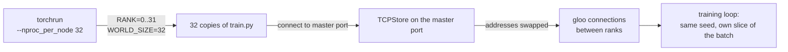

Then every rank does the same thing with different data:

- `torch.manual_seed(args.seed)` before building the model, so all 32 copies start from identical weights. Nothing is broadcast.
- `ids = order[(step * world + rank) * args.micro_batch :][: args.micro_batch]` (train.py:182) picks rank r's 4 sequences of this step. The global batch is 4 x N sequences of 128 tokens: 16,384 tokens at N = 32, 512 at N = 1.
- Only rank 0 prints and writes files. The other 31 compute silently.

One consequence to keep in mind for Part 14: the global batch grows with N, so the sweep's runs at different N see different data. Their losses differ for that reason only (8.3402 at step 1 for N = 1, 8.3516 for N = 32).

### 10.3 Threads, processes and memory

`train.py` gives each rank `max(1, 10 // N)` PyTorch threads (train.py:126). The sweep's `config.json` files record 10 threads at N = 1, 5 at N = 2, 2 at N = 4 and 1 from N = 8 up. At N = 32 that is 32 single-threaded processes on 10 cores, and the operating system takes turns running them. torchrun also sets `OMP_NUM_THREADS=1` whenever it starts more than one process, and says so in a warning you can ignore (Part 17.8).

Each rank is a full Python process with PyTorch loaded. During the build one rank used about 217 MB of resident memory (RSS), so 32 ranks take about 6.9 GB of the 16 GB. Notice how little of that is training state: model states are at most 67.7 MB per rank and activations 25.75 MB. The rest is the interpreter, PyTorch's libraries and gloo's buffers. So the ledger's numbers in Parts 13 to 15 are not the process size. They are what a GPU would hold.

### 10.4 Why every step is slow: bf16 on this CPU

The lecture said we run forward and backward in bf16 because on a GPU it is fast and small (Part 2.2). On this CPU it is small and slow. A 512 x 256 by 256 x 1024 matmul takes 80 ms in bf16 and 0.30 ms in fp32 on one thread, about 270 times slower. fp16 is just as slow. Apple's fast matrix hardware (reached through the Accelerate library) only does fp32, so bf16 falls back to a slow generic path.

I kept bf16 anyway. The whole point of the lab is the paper's 2 + 2 + 12 byte split, and fp32 working weights would make it 4 + 4 + 12. The price is time. A step at N = 32 took about 12.5 s in a smoke test on a cool laptop and 19.4 to 21.1 s in the sweep, after the fanless Air had heated up. So every timing in this lab is a trend, never a benchmark.

### 10.5 What to run, and how long it takes

`runs.sh` runs everything in order:

| step | command | wall time on our M4 |
|---|---|---|
| equivalence test | `uv run pytest test_zero.py -q` | 5 s |
| scaling sweep, 24 runs of 5 steps | `uv run sweep.py --out runs/sweep --steps 5` | 864 s, about 14 minutes (sum of the "wall" column in `runs/all.log`) |
| four main runs, N = 32, 60 steps each | `torchrun --nproc_per_node 32 ... --max-steps 60 --eval-every 30` | about 21 s per step, so a bit over 21 minutes each; {{MAIN_RUNS_WALL_MIN}} minutes for all four |
| plots | `uv run plot.py --runs runs --out plots` | seconds |

The header of `runs.sh` says "about 70 minutes". That was measured on a cool laptop at 12.5 s per step. Hot, it is closer to {{RUNS_SH_TOTAL_MIN}} minutes.

The notebook `zero.ipynb` runs the same commands. Its first cell has a switch, `RERUN = False`. With it off, each cell prints the log that `runs.sh` already wrote under `runs/` (and runs the command only if that log is missing), so the notebook opens in seconds. Set `RERUN = True` to run everything again.

Each main run uses its own port (`--master_port 2990$s`), the sweep uses `29800 + 4N + stage` and the test `29600 + N`. Part 17.1 explains why.

---

## Part 11: A tour of zero.py

`zero.py` is 452 lines. `train.py` builds the model, hands it to `ZeRO`, and calls four methods per step: `zero_grad`, `forward`, `backward`, `step`. Everything that differs between DDP and the three ZeRO stages lives behind those four calls. This part maps each piece to the lecture part it implements.

| piece | lines | what it does | lecture |
|---|---|---|---|
| `Ledger` | zero.py:42-89 | counts bytes held, by category, and the peak | Part 2.1, 7.4 |
| `Comm` | zero.py:92-130 | runs every collective and counts bytes sent | Part 4.2 |
| `Unit` | zero.py:133-169 | one flat buffer per group of parameters, plus this rank's slice | Part 6.2 |
| `model_units` | zero.py:172-178 | cuts the GPT into unit 0 and one unit per block | Part 6.2 |
| `adam_` | zero.py:181-198 | AdamW on flat fp32 tensors | Part 2.2, 5.1 |
| `ZeRO.__init__` | zero.py:213-256 | allocates what each stage keeps | Parts 5.2, 6.3, 7.3 |
| fetch, drop, hooks | zero.py:260-318 | moves weights and gradients during forward and backward | Parts 6.2, 7.1, 7.2 |
| `step` | zero.py:351-402 | reduce, clip, update, share | Parts 3.1, 5.1, 6.4 |
| `full_state` | zero.py:418-434 | gathers the whole fp32 model, for checkpoints and the test | Part 12 |
| `predicted_bill` | zero.py:441-452 | the formulas, in bytes | Parts 5 to 7 |

### 11.1 Ledger and Comm: the two counters

`Ledger` has three numbers, one per category (`params`, `grads`, `optimizer`). Every buffer the engine creates or frees goes through `alloc` or `free`, and `_changed` keeps the peak total plus the split at that moment. Between `record()` and `stop()` it also keeps every change as an event, which is how `plots/timeline.png` is drawn (Part 15).

Be clear about what the ledger is. It is bookkeeping kept by our code, not a reading from PyTorch's allocator or the operating system. It proves that the engine allocates and frees exactly the buffers the lecture says, at the moments the lecture says. Activations are counted separately, by `saved_activations` in `train.py:55`, which uses a saved-tensors hook to add up every tensor autograd keeps for backward during step 2.

`Comm` wraps the three collectives and counts bytes with the ring formula from Part 4.2:

```python
self.sent[kind] += round(nbytes * (self.world - 1) / self.world) * (2 if kind == "all_reduce" else 1)
```

That is zero.py:110. It is the paper's cost model, not a packet capture. gloo may pick another algorithm inside, but the ring cost is what the paper and every ZeRO discussion use, and it is what lets us compare to Part 8. `Comm.seconds` adds up the wall time spent inside collectives, which includes waiting for the slowest rank to arrive (Part 16.2).

### 11.2 Unit: the flat buffer trick

```python
self.padded = math.ceil(self.numel / world) * world
self.shard = self.padded // world
self.lo, self.hi = rank * self.shard, (rank + 1) * self.shard
```

A unit lays all its parameters end to end in one flat tensor, padded up to a multiple of N so it splits into N equal slices. Rank r owns `flat[lo:hi]`. Our unit sizes, 1,081,856 and 787,456, both divide by 32, so there is no padding anywhere in our runs. At N = 3 there is (Part 18, experiment 9).

`point_params_at` is the line that keeps `model.py` unchanged:

```python
p.data = flat[off : off + p.numel()].view(p.shape)
```

After it, every parameter is a view into the unit's flat buffer. The model reads its weights as usual, but a collective on the flat buffer now updates every parameter in the unit at once. `point_grads_at` does the same for `.grad`, so autograd adds gradients straight into a flat buffer we chose.

`Unit` also works out which ranges of my slice get weight decay: matrices yes, LayerNorm gains and biases no, the same rule as a10. A slice can start in the middle of one matrix and end in the middle of the next, so `decay` is a list of ranges, not a flag.

### 11.3 model_units and adam_

`model_units` puts `tok_emb`, `pos_emb` and `ln_f` into unit 0 (the output head is the same Parameter as `tok_emb.weight`, so it is in there too) and makes each block a unit. Its assert, `"a parameter is in no unit"`, fires if you change the model and forget a parameter.

`adam_` is AdamW written out: decay the matrix ranges, update m and v, divide by the bias-corrected square root of v. Two details. The clip factor from Part 6.4 is folded into the m and v updates instead of scaling the gradient first, so no gradient copy is made. And it works through the buffer 65,536 numbers at a time (`ADAM_CHUNK`), so its scratch space stays at 256 KB instead of a full temporary the size of the slice.

### 11.4 ZeRO.__init__: who keeps what

The constructor walks the units and allocates, per stage:

| buffer | DDP | ZeRO-1 | ZeRO-2 | ZeRO-3 |
|---|---|---|---|---|
| `full`: working weights, whole unit | kept | kept | kept | storage emptied, filled only while the unit runs |
| `mine`: my slice of working weights | | | | kept |
| `gfull`: whole gradient | kept | kept | only during the unit's backward | only during the unit's backward |
| `gmine`: my slice of the summed gradient | | only inside `step` | kept | kept |
| `master`, `m`, `v` in fp32 | whole unit | my slice | my slice | my slice |

ZeRO-1, the stage that saves the most memory for the least code, is one line (zero.py:235):

```python
own = flat if stage == 0 else flat[u.lo : u.hi]
```

Master weights, m and v are built from `own`, so DDP gets the whole unit and every ZeRO stage gets 1/N of it. Each allocation calls `ledger.alloc` with the exact byte count.

### 11.5 The hooks: fetching and freeing without touching model.py

Part 7.2 listed four hooks. Here is where they are installed (zero.py:282-288):

```python
for i, block in enumerate(self.model.blocks, start=1):
    if self.stage == 3:
        block.register_forward_pre_hook(lambda mod, args, i=i: self._fetch_weights(i))
    block.register_forward_hook(lambda mod, args, out, i=i: self._after_forward(i, out))
for i, u in enumerate(self.units):
    for p in u.params:
        p.register_post_accumulate_grad_hook(lambda p, i=i: self._grad_ready(i))
```

And this is the order they fire in for one block under ZeRO-3:

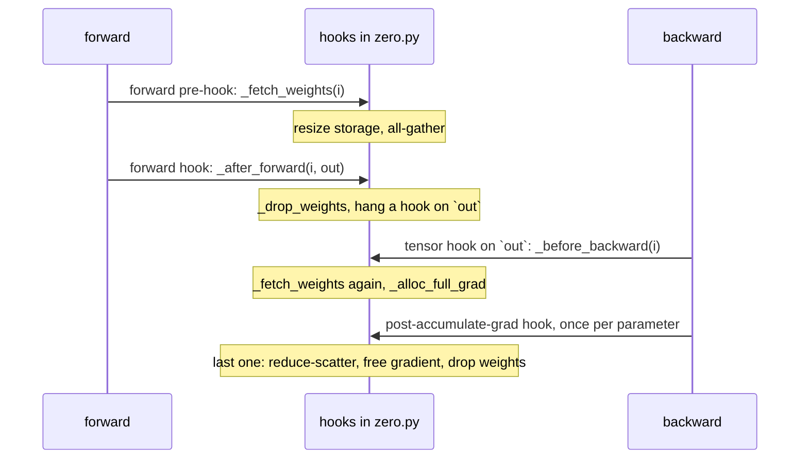

ZeRO-2 installs the same hooks minus the fetches and drops. Unit 0 has no module of its own, so `forward()` fetches it before calling the model and `backward()` opens its full gradient before calling `loss.backward()`. Its parameters still count down through `_grad_ready`. The tied matrix is a single Parameter, so autograd adds the head's and the embedding's contributions together and fires its hook once. The assert at the end of `backward`, `"units never finished their gradients"`, would catch it if that ever stopped being true.

Why `untyped_storage().resize_(0)` and not `del`? Autograd keeps references to the weight views it needs for backward. Deleting our Python name frees nothing while autograd holds them, and swapping in a new tensor would leave autograd holding the old one. Resizing the storage to zero bytes frees the memory but keeps the tensor objects. When `_fetch_weights` grows the storage back and all-gathers into it, the references autograd saved see the right numbers again. Forget the refill and you get Part 17.5's error.

### 11.6 step: the four moves

`step` is commented as four numbered moves, and they are Part 5.1's list:

1. Get each summed gradient to its owner. DDP all-reduces each unit. ZeRO-1 allocates a slice buffer per unit and reduce-scatters into it. ZeRO-2 and ZeRO-3 have nothing to do here, because the hooks already reduce-scattered during backward.
2. Global gradient norm. Each rank sums the squares of its slices in float64, and one all-reduce of that single 8-byte number adds the ranks together (Part 6.4).
3. AdamW on what this rank owns.
4. Copy the fp32 master into the bf16 working weights. ZeRO-1 and ZeRO-2 all-gather the new weights right away. ZeRO-3 only updates `mine`; the next forward gathers it.

ZeRO-1's slice buffers exist only inside `step`. That is a real cost, and Part 13.3 measures it.

### 11.7 full_state and predicted_bill

`full_state` all-gathers the fp32 master weights so rank 0 can save one file. It calls `dist.all_gather_into_tensor` directly, so this traffic is not in `Comm`'s count; it is not part of a training step. `predicted_bill` is the module docstring's table turned into bytes, using padded sizes so it can match the ledger exactly.

### 11.8 The real systems' knobs, in our lines

Part 9.3 promised each FSDP or DeepSpeed setting would be a line here:

| setting | our equivalent |
|---|---|
| DeepSpeed `stage`, FSDP `ShardingStrategy` | the `stage` argument and the `if stage ...` branches in `__init__` |
| FSDP wrapping policy, DeepSpeed buckets | `model_units`: what moves together |
| FSDP2 `reshard_after_forward=True` | `_drop_weights` inside `_after_forward` |
| keeping the root module's weights for backward | `forward()` gathering unit 0 once and `_grad_ready` dropping it at the end |
| `forward_prefetch`, `backward_prefetch`, `stage3_prefetch_bucket_size` | missing. Part 18, experiment 1 |
| DDP's gradient bucketing and overlap | missing. DDP all-reduces after backward. Part 18, experiment 11 |

---

## Part 12: Proving the stages are the same

### 12.1 The equivalence test

ZeRO moves numbers around. It must never change them. `test_zero.py` checks this the strict way. For each stage, every rank builds a tiny GPT from seed 0 (vocab 256, context 32, 2 layers, width 64, 2 heads), trains 5 steps on fixed random tokens with micro-batch 2, and `full_state()` gathers the final fp32 master weights. Rank 0 then trains one more copy alone, on the whole global batch, with `torch.optim.AdamW` and `clip_grad_norm_`. That is the reference nobody wrote by hand.

Three checks:

1. DDP matches the PyTorch reference within 1e-5 per weight.
2. The reference weights moved more than 1e-3 from their starting values. Without this, a bug that never updates anything would pass checks 1 and 3.
3. ZeRO-1, 2 and 3 each match DDP within 1e-5.

The result, at 4 ranks and at 3: all four stages end within 3.4e-7 of `torch.optim.AdamW`, after the weights moved 5.0e-3 from their starting point. The disagreement is about 15,000 times smaller than the movement. Both tests together ran in 5.07 s.

Why fp32 and not bf16? bf16 keeps 8 bits of precision, so one rounding difference is already about 0.4% of the number. A tolerance loose enough for bf16 would also pass a stage that dropped a small gradient. fp32's rounding step is about 6e-8, and 3.4e-7 is a few of those.

Why 3 ranks as well as 4? Because 3 divides none of the unit sizes, so the padding code runs: the last rank's slice ends in padding zeros, and decay ranges cut matrices at odd places. Padding stays harmless for a simple reason. A padding slot never gets a gradient, so its m and v stay 0 and its Adam update is 0 / (0 + eps) = 0.

### 12.2 bf16 at full size: the sweep

The test is small and fp32. The sweep checks the real thing: our 4.2M-parameter GPT, bf16, on 1 to 32 ranks. For every N, the four stages printed the same loss at every step, to every digit. At N = 4 the printed steps 1, 2, 3 and 5 read 8.3552, 8.2790, 8.1736 and 7.9938 for all four stages. In `metrics.jsonl`, which stores full float64 values, the losses are bit-identical across stages at all six N for all five steps. The gradient norms differ, by at most 2.0e-16 relative, because DDP sums the squares in a different order.

I expected bf16 rounding noise here and got none. The weights are identical after every step, which means the summed gradients and the Adam updates are identical to the last bit. Two things make that possible. Adam works number by number, so running it on a slice gives the same bits as running it on the whole buffer. And gloo appears to add the 32 contributions to each number in the same order whether you call it an all-reduce or a reduce-scatter plus all-gather.

The first DDP main run also reproduced the sweep's N = 32 run to the bit for its first five steps (8.35160967707634 at step 1), because both use the same seed and the same data order.

### 12.3 Sixty steps at N = 32

`plots/loss.png` draws the four 60-step training curves at N = 32 (top) and each ZeRO stage's loss minus DDP's at the same step (bottom). The learning rate warms up for 20 steps to 1e-3 and then follows a cosine down to 1e-4 at step 60.

| stage | train loss, step 60 | held-out loss, step 30 | held-out loss, step 60 | largest gap to DDP over 60 steps |
|---|---|---|---|---|
| DDP | {{S0_N32_TRAIN60}} | {{S0_N32_EVAL30}} | {{S0_N32_EVAL60}} | (baseline) |
| ZeRO-1 | {{S1_N32_TRAIN60}} | {{S1_N32_EVAL30}} | {{S1_N32_EVAL60}} | {{S1_N32_MAXDIFF}} |
| ZeRO-2 | {{S2_N32_TRAIN60}} | {{S2_N32_EVAL30}} | {{S2_N32_EVAL60}} | {{S2_N32_MAXDIFF}} |
| ZeRO-3 | {{S3_N32_TRAIN60}} | {{S3_N32_EVAL30}} | {{S3_N32_EVAL60}} | {{S3_N32_MAXDIFF}} |

Before training, the held-out loss is 8.3497, a little worse than guessing uniformly over 4,096 tokens (ln 4096 = 8.3178), because random initial logits are not perfectly flat. By step 10 the DDP training loss was 7.6545.

---

## Part 13: Memory at N = 32

### 13.1 Between steps: predicted and measured

The first block `train.py` prints is the predicted bill. The last block is what the ledger measured after the final step. At N = 32 (sweep runs, bytes converted to MB):

| stage | weights pred. / meas. | gradients pred. / meas. | optimizer pred. / meas. | total |
|---|---|---|---|---|
| DDP | 8.46 / 8.46 | 8.46 / 8.46 | 50.78 / 50.78 | 67.71 |
| ZeRO-1 | 8.46 / 8.46 | 8.46 / 8.46 | 1.59 / 1.59 | 18.51 |
| ZeRO-2 | 8.46 / 8.46 | 0.26 / 0.26 | 1.59 / 1.59 | 10.31 |
| ZeRO-3 | 0.26 / 0.26 | 0.26 / 0.26 | 1.59 / 1.59 | 2.12 |

Measured equals predicted to the byte, in every category, at every stage and every N in the sweep. That is 72 comparisons with no mismatch. These are the check-yourself answers of Parts 5 and 7 (18.5 MB and 2.12 MB), now measured.

Compare with the 8-parameter example. On 4 GPUs it gave 128, 56, 44 and 32 bytes, ratios of 1 : 0.4375 : 0.344 : 0.25. Our sweep at N = 4 gives 67.71, 29.62, 23.27 and 16.93 MB. Divide by 67.71 and you get the same four ratios. The toy was not a simplification. It was the whole model at a smaller Ψ.

### 13.2 The peak inside a step

| stage | between steps | peak | peak split: weights / gradients / optimizer | peak extra |
|---|---|---|---|---|
| DDP | 67.71 | 67.71 | 8.46 / 8.46 / 50.78 | 0 |
| ZeRO-1 | 18.51 | 18.78 | 8.46 / 8.73 / 1.59 | 0.26 |
| ZeRO-2 | 10.31 | 14.05 | 8.46 / 4.00 / 1.59 | 3.74 |
| ZeRO-3 | 2.12 | 9.59 | 4.00 / 4.00 / 1.59 | 7.48 |

All 32 ranks reported the same peak (`peak over ranks: min 9.59 MB, max 9.59 MB` for ZeRO-3). The ranks are symmetric.

The peak extras are exact multiples of two unit sizes. ZeRO-2's gradients at the peak are 4,003,104 bytes. Take away the permanent slices (264,480 bytes) and 3,738,624 bytes remain, which is 2 bytes x (1,081,856 + 787,456): the full gradient of unit 0 plus the full gradient of one block. That is Part 6.2's "at most two full unit gradients" in bytes. ZeRO-3 holds the same two units in full twice, once as weights and once as gradients, so its extra is 2 x 3,738,624 = 7,477,248 bytes. ZeRO-1's extra is its 264,480-byte gradient slice buffer from `step`.

Unit 0 is the reason the peak is so large. It holds the output head, which backward reaches first, and the embedding, which backward reaches last, so its full gradient (and under ZeRO-3 its full weights) stays open for the entire backward pass. At 1,081,856 parameters it is also our biggest unit. At N = 32, ZeRO-3's peak is 4.5 times its between-steps memory. Part 7.4 said this would happen for a toy with 4 blocks and a big embedding. A model with 80 layers would see a peak extra near 1/80 of its size.

### 13.3 An honest cost: ZeRO-1 at N = 1

ZeRO-1's peak at N = 1 is 76.17 MB, higher than DDP's 67.71 MB. The reason is in `step`: ZeRO-1 reduce-scatters into a separate slice buffer, and at N = 1 the "slice" is the whole gradient, 8.46 MB. At N = 32 the same buffer is 0.26 MB, which is the 0.26 MB extra in the table above. Part 7.4 warned that this buffer is 2Ψ/N: small only when N is large. A production implementation could reduce-scatter into the owner's own part of the full gradient buffer and skip the copy. I kept the separate buffer because it makes the code read like Part 5.1's list.

### 13.4 Activations

Activations were 25,750,564 bytes (25.75 MB) per rank at every stage and every N, because each rank always runs 4 sequences of 128 tokens through the full model. At N = 32 they are 12 times ZeRO-3's model states between steps (25.75 MB against 2.12 MB) and 2.7 times its peak. Part 9.1 said ZeRO does not touch activations. Here it is in one number: after ZeRO-3, activations are 92% of what a rank holds between steps.

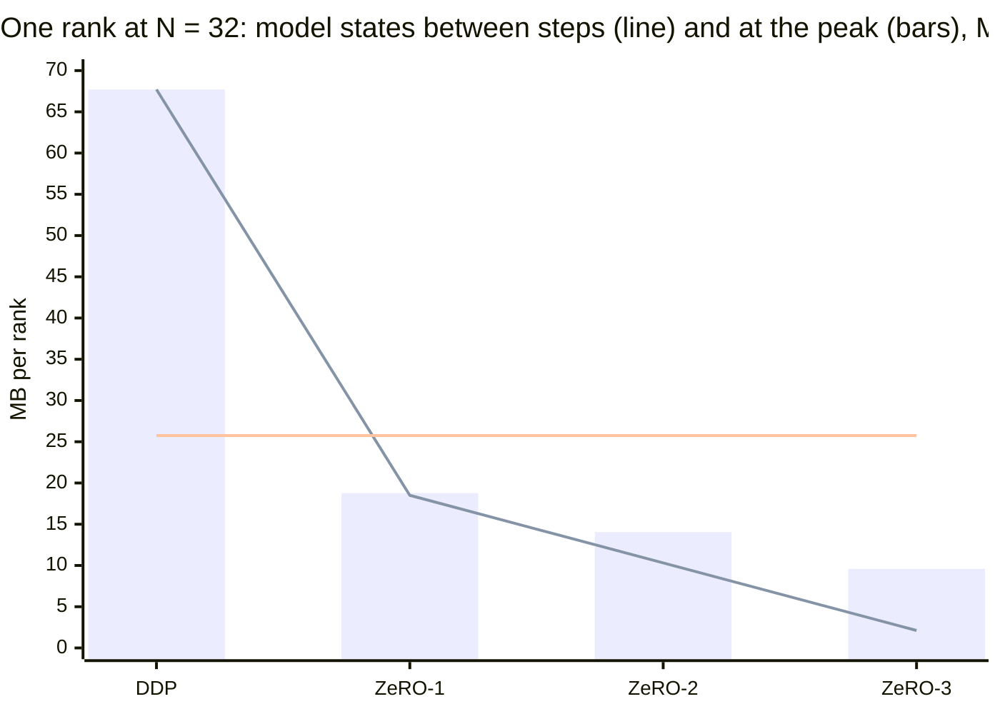

The flat line is activations. `plots/memory.png` draws the same numbers as stacked bars, weights in violet, gradients in pink, optimizer in green, activations hatched grey: the top panel between steps, the bottom panel at the peak.

**What to take away.** The formulas from Parts 5 to 7 hold to the byte. The peak is a different story: on a model with a few big units it is set by the two largest units, not by 1/N.

---

## Part 14: The scaling sweep

### 14.1 The table

`sweep.py` ran every stage at N = 1, 2, 4, 8, 16 and 32, five steps each. Memory per rank in MB, between steps and at the peak:

| N | DDP | ZeRO-1 | ZeRO-2 | ZeRO-3 |
|---|---|---|---|---|
| 1 | 67.71 / 67.71 | 67.71 / 76.17 | 67.71 / 71.45 | 67.71 / 75.18 |
| 2 | 67.71 / 67.71 | 42.32 / 46.55 | 38.09 / 41.82 | 33.85 / 41.33 |
| 4 | 67.71 / 67.71 | 29.62 / 31.74 | 23.27 / 27.01 | 16.93 / 24.40 |
| 8 | 67.71 / 67.71 | 23.27 / 24.33 | 15.87 / 19.61 | 8.46 / 15.94 |
| 16 | 67.71 / 67.71 | 20.10 / 20.63 | 12.17 / 15.90 | 4.23 / 11.71 |
| 32 | 67.71 / 67.71 | 18.51 / 18.78 | 10.31 / 14.05 | 2.12 / 9.59 |

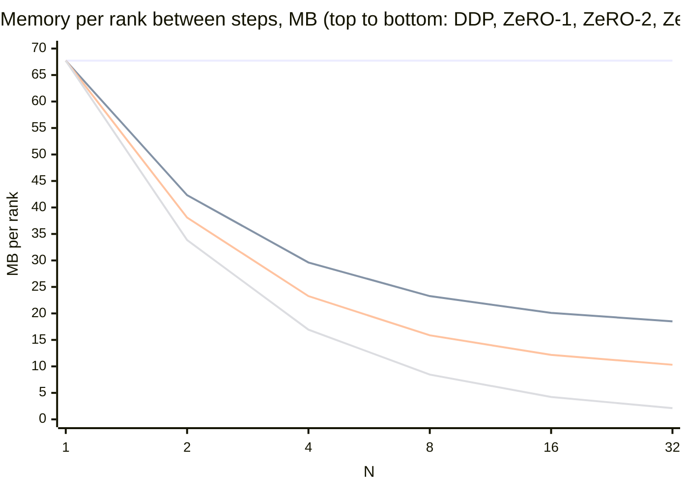

`plots/scaling.png` has the same lines, with the peak in a second panel.

### 14.2 Checking the formulas

With Ψ = 4,231,680 and bytes per number as in Part 2.2:

| stage | formula, bytes | at N = 8 | measured |
|---|---|---|---|
| ZeRO-1 | 4Ψ + 12Ψ/N | 16.93 + 6.35 = 23.27 MB | 23.27 MB |
| ZeRO-2 | 2Ψ + 14Ψ/N | 8.46 + 7.41 = 15.87 MB | 15.87 MB |
| ZeRO-3 | 16Ψ/N | 8.46 MB | 8.46 MB |

The match holds at every N, to the byte, because no unit needs padding at these N: 1,081,856 / 32 = 33,808 and 787,456 / 32 = 24,608.

A small coincidence in the table: ZeRO-2 at N = 4 and ZeRO-1 at N = 8 are both 23.27 MB, since 2Ψ + 14Ψ/4 and 4Ψ + 12Ψ/8 are both 5.5Ψ. Each stage buys you a factor of N on some piles, and a higher stage on fewer GPUs can match a lower stage on more.

### 14.3 Where the curves flatten, and why

Each stage has a floor: the part it does not shard.

- **ZeRO-1** never goes below 4Ψ = 16.93 MB, its full bf16 weights and gradients. At N = 32 it is at 18.51 MB. The last doubling, 16 to 32, saved only 1.59 MB.
- **ZeRO-2** never goes below 2Ψ = 8.46 MB, its full weights. At N = 32 it is at 10.31 MB.
- **ZeRO-3** has no floor between steps. It halves with every doubling, 67.71 / N.

The peaks flatten sooner. The peak extra does not depend on N at all: 3.74 MB for ZeRO-2 and 7.48 MB for ZeRO-3 at every N in the sweep, because one block and unit 0 are the same size no matter how many ranks there are. So ZeRO-3's peak heads for 7.48 MB, and at N = 32 it is 9.59 MB, of which 2.12 MB is the sharded state.

That fixed extra explains N = 2, where ZeRO-3's peak (41.33 MB) barely beats ZeRO-2's (41.82 MB). Sharding the weights saved 4.23 MB between steps, and borrowing unit 0 and a block as full weights cost 3.74 MB back. Net: 0.49 MB.

### 14.4 N = 1: every ZeRO stage loses

At N = 1 all three ZeRO peaks are above DDP's 67.71 MB: 76.17, 71.45 and 75.18 MB. There is nothing to shard with one rank, so a "slice" is the whole buffer, and every buffer ZeRO borrows comes on top. ZeRO-2's persistent gradient "slice" is the whole 8.46 MB gradient and backward still opens full buffers for unit 0 and one block (+3.74 MB). ZeRO-3 does the same for weights and gradients (+7.48 MB). ZeRO-1 was covered in Part 13.3. From N = 2 up, every stage beats DDP at the peak.

**What to take away.** Between steps, every stage follows its formula exactly and flattens at the pile it does not shard. The peak flattens earlier, at the size of the units you borrow, which is why real systems cut models into many small units.

---

## Part 15: One step, allocation by allocation

`plots/timeline.png` shows every `alloc` and `free` on rank 0 during step 2, one panel per stage. The x axis counts events, not seconds. It uses the N = 4 sweep runs (`runs/sweep/s<stage>_n4/timeline.json`): at N = 32, DDP's 67.7 MB and ZeRO-3's 2.1 MB on one shared y axis would flatten ZeRO-3 into a line, and at N = 4 all four panels stay readable. The panels show model states only. Activations are not in the ledger (Part 11.1).

### 15.1 DDP: five events, nothing moves

DDP's timeline has 5 events, all of them phase markers. Memory sits at 67.71 MB from start to finish. Every buffer already exists before the step and still exists after it. There is nothing to see, and that is the point: DDP's memory is all permanent.

### 15.2 ZeRO-1: the slices appear in the optimizer step

ZeRO-1 sits at 29.62 MB through forward and backward. In the optimizer step it allocates one gradient slice per unit just before that unit's reduce-scatter: 0.54 MB for unit 0, then 0.39 MB for each block. After the fifth it peaks at 31.74 MB. After the all-gather it frees all five, back to 29.62 MB. The extra, 2.12 MB, is 2Ψ/4, the slice buffer from Part 13.3.

### 15.3 ZeRO-2: a sawtooth in backward

ZeRO-2 starts at 23.27 MB. Then, in backward:

1. `backward()` opens unit 0's full gradient: 25.44 MB.
2. Block 3's tensor hook opens block 3's full gradient: 27.01 MB, the peak.
3. Block 3's last parameter reports in, `_grad_ready` reduce-scatters and frees: 25.44 MB.
4. Steps 2 and 3 repeat for blocks 2, 1 and 0. The peak of 27.01 MB is reached four times.
5. The embedding's gradient arrives last, unit 0 is reduce-scattered and freed: 23.27 MB.

The optimizer step has no events at all, because the slices it needs already exist. This is the sequence diagram in Part 6.2, drawn by the code that implements it.

### 15.4 ZeRO-3: 33 events and nine gathers

ZeRO-3's panel is the busiest. Its rank-0 total, event by event:

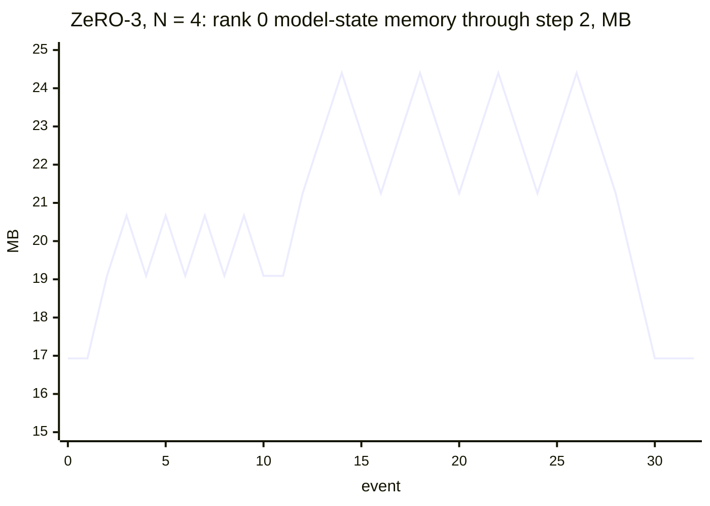

- **Forward (events 1 to 10).** Gather unit 0 (+2.16 MB, to 19.09 MB) and keep it. Then for each block, gather it (20.67 MB) and drop it (19.09 MB). Four small teeth.
- **Backward (events 11 to 28).** Open unit 0's gradient (21.25 MB). For each block, from block 3 down: gather its weights again (22.83 MB), open its full gradient (24.40 MB, the peak), reduce-scatter and free the gradient (22.83 MB), drop the weights (21.25 MB). Four tall teeth.
- **End of backward (events 29 and 30).** Unit 0's gradient is reduce-scattered and freed (19.09 MB), then its weights dropped (16.93 MB).
- **Optimizer step.** No events. Each rank updates its slices in place.

Count the gathers: unit 0 once, each block twice, nine in all. That is Part 7.1's sequence diagram, and the traffic Part 8.2 predicted.

**What to take away.** The timeline makes the lecture's sequence diagrams checkable. Every rise is a named buffer, every fall is the matching free, and the peaks land exactly where Parts 6.2 and 7.4 said: unit 0 plus one block.

---

## Part 16: Communication and time

### 16.1 Bytes per step

Bytes each rank sends per step at N = 32, counted by `Comm`:

| stage | all-reduce | reduce-scatter | all-gather | total | in Ψ x 2 bytes | vs DDP |
|---|---|---|---|---|---|---|
| DDP | 16,397,760 | 0 | 0 | 16,397,760 | 1.938 | 1.000 |
| ZeRO-1 | 16 | 8,198,880 | 8,198,880 | 16,397,776 | 1.938 | 1.000 |
| ZeRO-2 | 16 | 8,198,880 | 8,198,880 | 16,397,776 | 1.938 | 1.000 |
| ZeRO-3 | 16 | 8,198,880 | 14,301,664 | 22,500,560 | 2.659 | 1.372 |

DDP, ZeRO-1 and ZeRO-2 send 2 x 31/32 x Ψ x 2 bytes, Part 4.2's ring cost exactly. The 16 bytes of all-reduce in the ZeRO rows are the gradient norm: one 8-byte float64, all-reduced, 2 x 31/32 x 8 rounds to 16.

ZeRO-3 sends 2.659 x Ψ x 2 bytes, not 3 x 31/32 = 2.906. Part 8.2 predicted exactly this: unit 0 is gathered once per step because it is kept for the whole step, the blocks twice, so 2.744 x 31/32 = 2.659. Its all-gather row is 31/32 x 2 bytes x (Ψ + 4 x 787,456). And the ratio to DDP, 1.372, is the same at every N from 2 to 32, because both stages carry the same (N-1)/N factor.

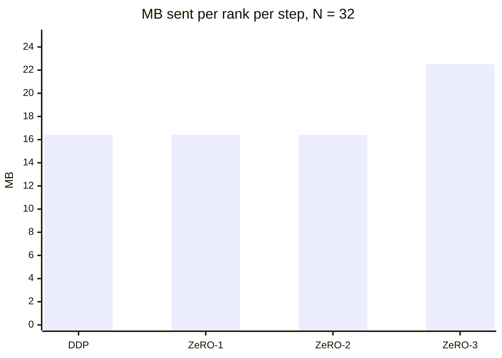

By reading the code you can also count the calls per step: DDP makes 5 all-reduces (one per unit). ZeRO-1 and ZeRO-2 make 5 reduce-scatters, 5 all-gathers and 1 tiny all-reduce. ZeRO-3 makes 5 reduce-scatters, 9 all-gathers and 1 tiny all-reduce.

The top panel of `plots/comm.png` divides bytes sent by the model's size in bytes and plots it against N. The DDP, ZeRO-1 and ZeRO-2 lines sit on top of each other and climb with (N-1)/N, from 1.00 at N = 2 to 1.94 at N = 32, toward the paper's 2. ZeRO-3's line climbs from 1.37 to 2.66, toward 2.744, below the paper's 3.

### 16.2 Time: trends only

Mean per step over steps 2 to 5 in the sweep at N = 32:

| stage | step time | inside collectives | optimizer |
|---|---|---|---|
| DDP | 19,575 ms | 638 ms | 234.6 ms |
| ZeRO-1 | 19,418 ms | 763 ms | 0.8 ms |
| ZeRO-2 | 20,492 ms | 1,322 ms | 1.2 ms |
| ZeRO-3 | 21,058 ms | 2,244 ms | 1.1 ms |

ZeRO-3's step is 7.6% slower than DDP's here. I would not quote that number anywhere else. Four things distort it:

- bf16 matmuls take the slow path (Part 10.4), so forward and backward are 89 to 96% of every step.
- 32 processes share 10 cores. A rank waits for a core as well as for data.
- "Inside collectives" includes waiting for the slowest rank to arrive. With 32 processes taking turns on 10 cores, that waiting is most of what the clock measures. DDP's collective time went from 9 ms at N = 2 to 638 ms at N = 32, while its bytes only went from 8.46 MB to 16.40 MB.
- The laptop has no fan, so it slowed down as it heated: 12.5 s per step cool, about 20 s hot.

The trend still tells you something. ZeRO-2 sends the same bytes as ZeRO-1 but spent 1.7 times as long in collectives (1,322 against 763 ms). My reading: ZeRO-1 waits for the other ranks once per step, after backward. ZeRO-2 waits five times, inside backward, and each wait lasts until the slowest rank has finished that unit. ZeRO-3 adds nine gathers on top. More synchronization points cost time even when the bytes do not change. On real GPUs, overlap and prefetch (Part 8.3) hide much of this.

Forward and backward work per rank does not change with the stage or with N: `fwd_bwd_flops_per_rank` is 12,999,720,960 (6 x Ψ x 512 tokens, 13.0 GFLOP) in all 24 runs. Step time still rises with N because the work per rank is fixed while cores per rank shrink. The whole machine's throughput went from 355 tokens/s at N = 1 to 837 tokens/s for DDP at N = 32.

### 16.3 Optimizer work

`optimizer_numbers_per_rank` is 4,231,680 for DDP at every N and 4,231,680 / N for every ZeRO stage, 132,240 at N = 32. That is Part 8.4's table, measured. The top panel of `plots/work.png` draws it on log axes: DDP flat, the three ZeRO stages on one line falling by half per doubling.

The optimizer time falls further than the work. At N = 1 all four stages take about 26 ms for Adam. At N = 32, DDP takes 234.6 ms and ZeRO-1 0.8 ms, about 290 times less for 32 times fewer numbers. 32 processes all running full-size Adam at once, each on one thread, fight over the same cores and memory bandwidth. ZeRO removes that contention along with the duplicated work.

### 16.4 The main runs

The bottom panel of `plots/work.png` splits the mean step of each 60-step main run into forward + backward, collectives and optimizer:

| stage | step time | inside collectives | optimizer |
|---|---|---|---|
| DDP | {{S0_N32_STEP_MS}} ms | {{S0_N32_COMM_MS}} ms | {{S0_N32_OPT_MS}} ms |
| ZeRO-1 | {{S1_N32_STEP_MS}} ms | {{S1_N32_COMM_MS}} ms | {{S1_N32_OPT_MS}} ms |
| ZeRO-2 | {{S2_N32_STEP_MS}} ms | {{S2_N32_COMM_MS}} ms | {{S2_N32_OPT_MS}} ms |
| ZeRO-3 | {{S3_N32_STEP_MS}} ms | {{S3_N32_COMM_MS}} ms | {{S3_N32_OPT_MS}} ms |

The four runs ran one after another on a laptop that kept heating up, so a later stage can look slower for reasons that have nothing to do with ZeRO.

**What to take away.** Bytes sent are exact and match Part 8 to three digits: ZeRO-1 and ZeRO-2 are free, ZeRO-3 costs 1.37 times DDP on this model. Time on this machine mostly measures how 32 processes share 10 cores.

---

## Part 17: When things go wrong

### 17.1 "address already in use"

The full message comes from the `TCPStore` that torchrun opens on the master port:

```
torch.distributed.DistNetworkError: The server socket has failed to listen on any local network address. port: 29500, useIpv6: false, code: -48, name: EADDRINUSE, message: address already in use
```

Something already holds the master port: a run still going, a run that crashed and left a process behind, or another project. Find it with `lsof -i :29500` and stop it (`pkill -f train.py` stops all of ours, including runs you meant to keep). Or give this run its own port with `--master_port`. That is why `runs.sh`, `sweep.py` and `test_zero.py` each pick different ports: two launches in a row on one port can collide while the first one is still shutting down.

### 17.2 "Timed out waiting 1800000ms for recv operation to complete"

A rank called a collective and its partners never did. As Part 4.1 said, gloo waits for its default timeout of 30 minutes (1,800,000 ms), then raises a `RuntimeError` whose message ends in the line above. So for half an hour the run just stops printing.

The usual causes: a collective inside `if rank == 0:`, a rank that runs out of data a step early, or a stage-dependent branch that one rank takes and another does not. Every collective must run on every rank, in the same order, with the same buffer sizes. This is why `train.py`'s logging all-reduce and `evaluate()` run on all ranks even though only rank 0 prints. While debugging, pass `timeout=datetime.timedelta(minutes=2)` to `init_process_group` so a hang turns into an error in two minutes.

### 17.3 "units never finished their gradients: [...]"

Our own assert, at the end of `ZeRO.backward` for stages 2 and 3. The list shows how many parameters each unit is still waiting for. A parameter that gets no gradient never fires its post-accumulate-grad hook, so its unit is never reduce-scattered and its slice keeps last step's gradient. The usual cause is a model change that leaves a parameter unused. Use every parameter in forward, or leave it out of the unit.

### 17.4 "a parameter is in no unit"

The assert in `model_units`. You added a parameter outside the blocks, or untied the output head from the embedding, and `model_units` does not know about it. Put it in unit 0 or give it a unit of its own (Part 18, experiment 2).

### 17.5 "setStorage: ... out of bounds for storage of size 0"

Something used a ZeRO-3 weight after `_drop_weights` emptied its storage and before `_fetch_weights` filled it again. On a small reproduction the error reads:

```
RuntimeError: setStorage: sizes [64, 64], strides [64, 1], storage offset 0, and itemsize 2 requiring a storage size of 8192 are out of bounds for storage of size 0
```

The sizes are the weight's shape and itemsize 2 is bf16. Common ways to get here: calling `model(x)` directly instead of `engine.forward(x)` under ZeRO-3 (unit 0 is never fetched), moving a drop earlier than the last use (for example dropping unit 0 after forward, when the head needs it at the start of backward), or adding a new module whose weights nobody fetches.

### 17.6 Too many processes for the memory

There is no single error message. macOS swaps instead of failing, so steps get much slower and Activity Monitor's memory pressure turns yellow or red. If the system does kill a rank, torchrun stops the others and raises `ChildFailedError`, naming the rank that died. Budget about 217 MB per rank: 32 ranks need about 6.9 GB, 64 would need about 13.9 GB of the 16 GB. Close other apps, use fewer ranks, or lower `--micro-batch` to shrink activations.

### 17.7 Every step takes 20 seconds

Expected. Part 10.4: bf16 matmuls take the slow path on this CPU, and a hot fanless laptop slows down further. To check that the slowness is the number format, run once with `--dtype fp32`. The bill changes too (Part 18, experiment 4), so do not mix fp32 and bf16 numbers in one table.

### 17.8 Warnings you can ignore

Three warnings appear in every log of ours and are harmless:

- `Setting OMP_NUM_THREADS environment variable for each process to be 1 in default, to avoid your system being overloaded, please further tune the variable for optimal performance in your application as needed.` torchrun sets it when it starts more than one process. `train.py` then sets PyTorch's own thread count (Part 10.3).
- `NOTE: Redirects are currently not supported in MacOs.` torchrun cannot redirect each rank's output to its own file on macOS. Nothing in this project uses that.
- ``VIRTUAL_ENV=... does not match the project environment path `.venv` and will be ignored``. uv found another environment active in your shell (ours was conda) and used the project's `.venv` anyway, which is what you want.

### 17.9 Odd world sizes and padding

Pick an N that does not divide the unit sizes, say 3, and the first line of the log shows padding: `4,231,680 params (4,231,689 after padding to a multiple of 3)`. Every bill and every byte count then uses the padded sizes, and measured still equals predicted. If you change `Unit` and drop the padding, expect a size error from `reduce_scatter_tensor` or `all_gather_into_tensor`, which need the full buffer to be exactly N times the slice. Or worse, no error and a tail of each unit that no rank owns. And never load per-rank files saved at one N into a run at another N: the slices will not line up.

### 17.10 "No such file or directory: '../a10-pipeline/data/fwe/meta.json'"

A `FileNotFoundError` on the first line of `main`: the data is not where `--data` points. Build it (Part 10.1, step 3) and pass `--data data/fwe`.

---

## Part 18: Experiments to try next

Each experiment changes one thing. Write your prediction down first, then run it and compare. Small experiments run fast at N = 4 or 8; use `sweep.py --worlds 4 8 --steps 3` and pass any `train.py` flag through.

1. **Prefetch in ZeRO-3.** In the forward pre-hook for block i, also start the all-gather for block i+1 with `async_op=True`, and wait on it in the next pre-hook. Do the same in reverse for backward. Predict: bytes unchanged at 2.659 Ψ; peak up by one block's weights, 1.57 MB, from 9.59 to 11.17 MB at N = 32; time in collectives down, though less than on a GPU, because here gloo and the matmuls compete for the same cores.

2. **Untie the embedding and split unit 0.** Delete `self.lm_head.weight = self.tok_emb.weight` in a copy of `model.py`. The assert from Part 17.4 fires first: fix `model_units` to make an "embed" unit (`tok_emb`, `pos_emb`: 1,081,344 parameters) and a "head" unit (`ln_f`, `lm_head`: 1,049,088), and give both module hooks like the blocks. Predict: Ψ grows 25%, to 5,280,256. In backward the head finishes before block 3 starts, and the embedding is opened only at the very end, so the peak extra per category falls from two units (3.74 MB) toward one. ZeRO-3 traffic rises toward 3 x 31/32 = 2.906 Ψ, because no unit is kept for the whole step any more.

3. **Gradient accumulation.** Call `engine.backward` twice per step on two micro-batches, with one `zero_grad` before them. Predict: DDP and ZeRO-1 give the right gradient, because autograd adds into the permanent `gfull`. ZeRO-2 and ZeRO-3 silently keep only the second micro-batch, because `_grad_ready` reduce-scatters into `gmine` and overwrites it. Extend `test_zero.py` to catch it, then fix it with a temporary slice and an add. Count the cost: one reduce-scatter per micro-batch, so gradient traffic grows with the number of micro-batches. That is what DeepSpeed does at stage 2.

4. **fp32 working weights.** `--dtype fp32`. Predict: bytes per parameter become 4 + 4 + 12 = 20, so DDP holds 84.63 MB, and every byte sent doubles (DDP: 32.80 MB per step at N = 32). Steps should get much faster, since fp32 matmuls are about 270 times cheaper here. Note that a real fp32 run would drop the separate master copy and need 16 bytes, not 20.

5. **More layers.** `--layers 16`. Predict: Ψ = 13,681,152. ZeRO-3 at N = 32 holds 6.84 MB between steps. The peak extra stays 7.48 MB, because unit 0 and a block did not change size, so the peak is 14.32 MB. As a fraction of the model, unit 0 plus a block falls from 44% to 14%, roughly as 1/L. ZeRO-3 traffic rises from 2.659 to 2.830 Ψ, closer to the paper's 3, because unit 0 is now a smaller share. Activations grow too; predict by how much before you look.

6. **Bucket size.** In DDP, all-reduce once per parameter tensor instead of once per unit, then once for all five units joined into one buffer. Predict: bytes sent identical in all three. Time in collectives grows with the number of calls, because each call pays a fixed start-up cost and one more chance to wait for the slowest rank.

7. **Offload the optimizer slice.** Keep `master`, `m` and `v` in a memory-mapped file instead of RAM (`numpy.memmap` and `torch.from_numpy`). That is ZeRO-Infinity's NVMe offload in miniature. Predict: the ledger's optimizer bytes leave "device" memory; optimizer time grows. With ZeRO at N = 32 each rank's file is only 1.59 MB, so the slowdown may be small. Try DDP, which would need 50.78 MB per rank.

8. **Checkpoints: per rank or gathered.** Save each rank's `master`, `m` and `v` to its own file, then compare with `full_state()`. Predict: per-rank files of 12Ψ/N = 1.59 MB at N = 32, 50.78 MB in total, restartable only at N = 32 and with Adam's memory intact. `full_state()` produces 16.93 MB of fp32 weights (4Ψ) that load at any N, but m and v are lost, and every rank receives the whole model to build it.

9. **N = 3.** `uv run sweep.py --out runs/n3 --worlds 3`. Predict: `4,231,689 after padding to a multiple of 3` (unit 0 needs 1 padding number, each block 2), ZeRO-3 holds 16 x 4,231,689 / 3 = 22,569,008 bytes between steps, and the ledger still equals the bill to the byte. Each rank gets 3 threads.

10. **Activation checkpointing.** Wrap each block's forward in `torch.utils.checkpoint`. Predict: activations fall well below 25.75 MB and forward + backward costs about a third more (Part 9.1). Under ZeRO-3 I predict it breaks first. The recompute runs the block's forward again inside backward, which fires the forward hook, which drops the weights the recomputed backward is about to use. Expect Part 17.5's error, then decide how the hooks should tell a recompute from a real forward.

11. **Overlap DDP's all-reduce with backward.** In stage 0, hang `register_post_accumulate_grad_hook` on each parameter like stage 2 does, and start an async all-reduce per unit as soon as its gradient is complete. This is DDP's bucketing. Predict: bytes identical; step time falls by at most the time in collectives (638 ms at N = 32 in the sweep), and probably less here because the CPU is busy either way.

---

## Part 19: Glossary

| term | meaning |
|---|---|
| activation | a value from the forward pass kept for backward. ZeRO does not shard activations: 25.75 MB per rank here at every stage |
| activation checkpointing | keep only each block's input, recompute the rest during backward. Trades compute for activation memory |
| Adam m, v | Adam's two running averages per weight: m of the gradient, v of the squared gradient. fp32, 4 bytes each |
| all-gather | collective: each rank contributes one slice, every rank ends with all slices side by side |
| all-reduce | collective: every rank ends with the sum of everyone's buffers. A reduce-scatter followed by an all-gather |
| bf16 | 16-bit float with fp32's range and 8 bits of precision. Our working weights and gradients. Slow on this CPU (Part 10.4) |
| bucket | a group of gradients sent in one collective. DeepSpeed's word for what we call a unit |
| collective | an operation every rank must call together, with matching buffers, such as all-reduce |
| DDP | Distributed Data Parallel: every rank holds the full model and all-reduces gradients. Stage 0 here |
| DeepSpeed | Microsoft's training library, where ZeRO was first released |
| FSDP | Fully Sharded Data Parallel, PyTorch's built-in ZeRO-3 (and ZeRO-2 with `SHARD_GRAD_OP`) |
| gloo | PyTorch's collective backend for CPUs, over TCP. Ours |
| hook | a function PyTorch calls at a set moment: before or after a module's forward, when a tensor's gradient is computed, when a parameter's gradient is complete |
| ledger | our `Ledger` class: counts every byte the engine allocates or frees, by category, and the peak |
| master weights | the fp32 copy of every weight the optimizer updates. Turned back into bf16 after each step |
| mixed precision | bf16 for forward and backward, fp32 for the optimizer state and update |
| model states | weights, gradients and optimizer state: the three piles ZeRO shards |
| NCCL | NVIDIA's collective library for GPUs. What you would use on a real cluster instead of gloo |
| padding | zeros added to a unit so its length divides by N. None in our runs at N = 1 to 32 |
| peak memory | the most a rank holds at any moment of a step. Higher than steady state for ZeRO-2 and ZeRO-3 |
| prefetch | starting the next unit's all-gather while the current unit computes. Costs one more unit of memory |
| Ψ (psi) | the number of parameters: 4,231,680 for our GPT |
| rank | one process, one virtual GPU, numbered 0 to N-1 |
| reduce-scatter | collective: sum everyone's buffers, rank r keeps only slice r of the sum |
| ring | the algorithm behind the cost formulas: ranks in a circle, each sending to its neighbour, N-1 rounds |
| shard, slice | the 1/N piece of a buffer one rank owns. Rank r owns `flat[r * shard : (r + 1) * shard]` |
| steady state | what a rank holds between steps. What the Part 5 to 7 formulas describe |
| torchrun | PyTorch's launcher: starts N processes and sets `RANK`, `WORLD_SIZE` and the master address and port |
| unit | a group of parameters moved as one flat buffer. Here: unit 0 (embeddings, final LayerNorm, tied head) and one per block |
| world size | N, the number of ranks |
| ZeRO | Zero Redundancy Optimizer (Rajbhandari et al., 2020). Stage 1 shards optimizer state, 2 adds gradients, 3 adds weights |
| ZeRO-Offload | keeps the optimizer state, and optionally the update, in CPU memory. ZeRO-Infinity extends it to NVMe disks |
| ZeRO-R | the paper's fixes for the rest of memory: activation partitioning, fixed-size buffers, defragmentation |
| ZeRO++ | cuts ZeRO-3's traffic with int8 weight gathers, a second copy of shards inside each machine, and quantized gradients |
